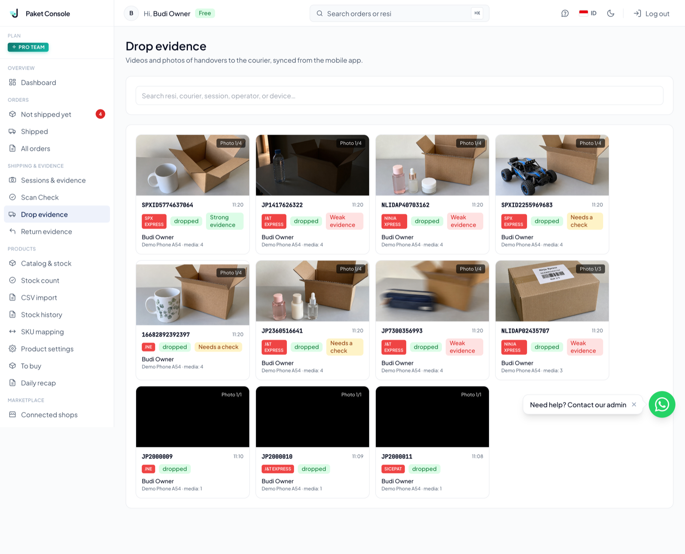
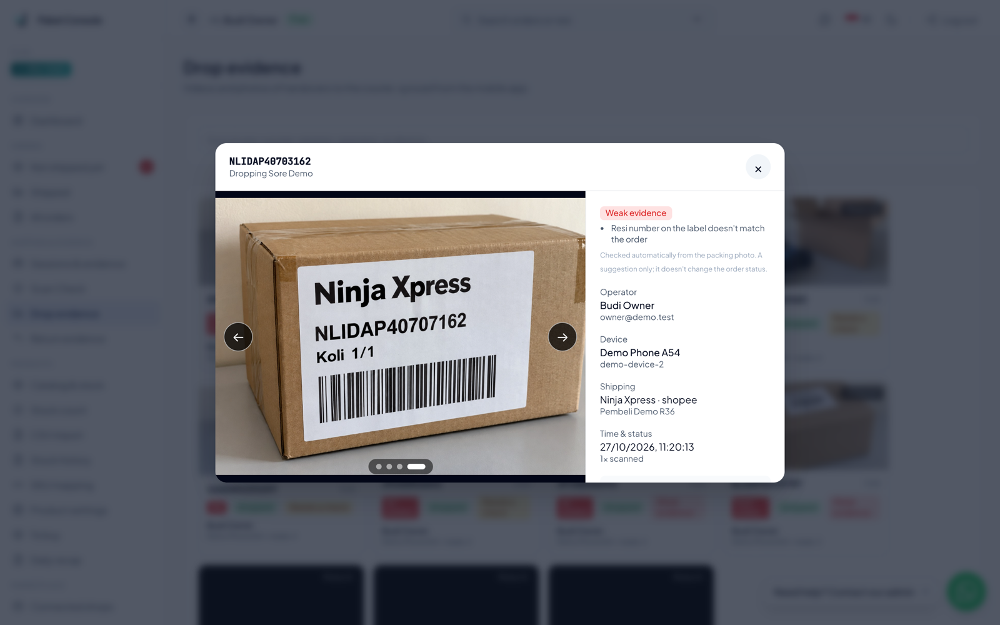

# ProofMuse inside the Jeejak console

The Jeejak console backend (`paket.jeejak.id`, Go) already ran an evidence
check on synced packing photos, on Gemini. During the hackathon we added
ProofMuse as a second backend for that check. The repository is private,
so the code that matters is quoted here.

- Pull request: adisatyaitconsultant/jeejak_paket.jeejak.id #391, merged
  2026-10-27 (merge commit `36ff35b`), four commits all dated 2026-10-27.
- Size without the agent notes file and `go.sum`: 15 files, +501 / -22,
  of which +267 are tests.
- **Off by default.** Production does not run it. The server refuses to
  boot with `PROOFMUSE_*` set unless `EVIDENCE_CHECK_DEMO_MODE=true`,
  which only a demo deployment with synthetic data sets.

## The flow

1. A seller packs a parcel in the JejakPaket app: resi scan, packing
   photos, handover to the courier.
2. Paid plans sync the record and photos to the console.
3. The console's evidence-check job sends the photos, the resi and the
   koli count to ProofMuse with the Go client in [`client/`](../client).
4. ProofMuse answers with the six-field observation the console already
   stores. The console's own rules decide the verdict, and the badge shows
   on the Drop evidence page.





Screens from the demo stack (`console-demo.jeejak.id`, a separate demo
tenant with staged photos only). Every verdict shown was set by the
console's check job calling ProofMuse. We also ran parcels through the
whole path, starting in the JejakPaket app: one on an Android emulator,
and one (CGK2610270005) on an iPhone 14 Pro, scanned, photographed,
handed over and synced, then checked by the console as Bukti kuat. The
iPhone photographed staged label images with a dummy waybill.

## The checker

`internal/evidencecheck/proofmuse/proofmuse.go`, the core of it:

```go
// Check sends the photos with the record's resi and koli. ProofMuse uses
// the resi only to decide whether a mismatching read must be re-read
// before it is reported; no model ever receives it (D15).
func (c *Checker) Check(ctx context.Context, req evidencecheck.Request) (evidencecheck.Observation, evidencecheck.Usage, error) {
	start := time.Now()
	usage := evidencecheck.Usage{Model: ModelID}
	res, err := c.Client.Observe(ctx, client.Request{Photos: req.Photos, Resi: req.Resi, Koli: req.Koli})
	usage.Latency = time.Since(start)
	switch {
	case errors.Is(err, client.ErrAuth), errors.Is(err, client.ErrLimit), errors.Is(err, client.ErrOff):
		return evidencecheck.Observation{}, usage, fmt.Errorf("%w: %w", ErrStop, err)
	// A rejected request (for example koli out of the server's range)
	// can never succeed as sent: store it without a verdict, like a
	// schema failure, instead of retrying it every run.
	case errors.Is(err, client.ErrInvalid), errors.Is(err, client.ErrRejected):
		return evidencecheck.Observation{}, usage, fmt.Errorf("%w: %w", evidencecheck.ErrSchema, err)
	case err != nil:
		return evidencecheck.Observation{}, usage, err
	}
	usage.InputTokens = res.Usage.InputTokens
	usage.OutputTokens = res.Usage.OutputTokens
	usage.ThoughtTokens = res.Usage.ReasoningTokens
	if res.Usage.Model != "" {
		usage.Model = "proofmuse/" + res.Usage.Model
	}
	// The server's answer goes through the same strict parser as a
	// model answer: an unexpected value is a schema failure, never a
	// verdict.
	raw, err := json.Marshal(res.Observation)
	if err != nil {
		return evidencecheck.Observation{}, usage, err
	}
	obs, err := evidencecheck.ParseObservation(raw)
	if err != nil {
		return evidencecheck.Observation{}, usage, err
	}
	return obs, usage, nil
}
```

The job key carries `ModelID = "proofmuse/muse-spark-1.3"`, so a record
already checked by Gemini is checked again by ProofMuse rather than
reusing the old row.

## Choosing the backend

`cmd/server/evidence_backend.go`:

```go
func evidenceBackend(ctx context.Context, ec config.EvidenceCheckConfig, newVertex vertexFactory) (evidencecheck.Checker, job.Key, string, error) {
	if ec.ProofMuseEnabled() {
		return proofmuse.New(ec.ProofMuseURL, ec.ProofMuseKey),
			job.Key{PromptVersion: proofmuse.PromptVersion, ModelID: proofmuse.ModelID},
			"proofmuse", nil
	}
	c, err := newVertex(ctx, vertex.Config{
		API: vertex.APIVertex, Project: ec.Project, Location: ec.Location,
		Model: ec.Model, MediaResolution: ec.MediaResolution,
	})
	if err != nil {
		return nil, job.Key{}, "", fmt.Errorf("evidence check: %w", err)
	}
	return c, job.Key{PromptVersion: evidencecheck.PromptVersion, ModelID: ec.Model, MediaResolution: ec.MediaResolution}, "vertex", nil
}
```

## The demo-only gate

`config/config.go`, inside `loadEvidenceCheck`:

```go
	if anyGemini && anyProofMuse {
		return e, errors.New("GEMINI_* and PROOFMUSE_* are both set: the evidence check runs one backend at a time (Plan 0016 D15)")
	}
	...
	if anyProofMuse && !e.ProofMuseEnabled() {
		return e, errors.New("PROOFMUSE_URL and PROOFMUSE_API_KEY must be set together (Plan 0016 D15)")
	}
	if anyProofMuse {
		if err := checkProofMuseURL(e.ProofMuseURL); err != nil {
			return e, err
		}
		// D15: demo deployments only, enforced the same way D14 gates
		// the synthetic-demo acknowledgement. Production never sets
		// EVIDENCE_CHECK_DEMO_MODE, so it can never run this backend.
		if !e.DemoMode {
			return e, errors.New("PROOFMUSE_* requires EVIDENCE_CHECK_DEMO_MODE=true: the ProofMuse backend runs on demo deployments with synthetic data only until the privacy policy names Meta (Plan 0016 D15)")
		}
	}
```

Why the gate: the hackathon runs on free Meta Model API credits, whose
terms allow content to be used for product improvement. Real seller photos
stay out of it until the privacy policy names Meta and the account is on
paid usage.

## What else changed

- `internal/evidencecheck/checker.go` and `job/job.go`: the request now
  carries the resi, and a `ErrStop` refusal (bad key, daily limit, API
  off) stops the run instead of burning through every record.
- `internal/evidencecheck/vertex/vertex_test.go`: a test that the Gemini
  backend still never sends the resi to its model, compared
  case-insensitively.
- `run.sh` and `.env.example`: the two variables, operator-only.
- Tests: the checker's error mapping and observation mapping, the backend
  selector, each config refusal, and a job integration test against
  Postgres.
